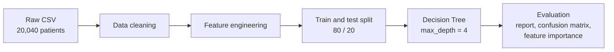

<div align="center">


<p>
  
  
  
  
  
</p>

**A complete data science workflow in one notebook:** cleaning inconsistent real-world records, engineering features, and training an interpretable Decision Tree to predict cardiac risk in hospital patients.

</div>

> ⚠️ **Educational project.** This model is not a medical device and must not be used for clinical decisions.

---

## Table of contents

- [Results at a glance](#-results-at-a-glance)
- [Pipeline](#-pipeline)
- [Dataset](#-dataset)
- [Data cleaning highlights](#-data-cleaning-highlights)
- [Model](#-model)
- [Visualizations](#-visualizations)
- [Project structure](#-project-structure)
- [Getting started](#-getting-started)
- [Author](#-author)

---

## 🏆 Results at a glance

<div align="center">

| Train accuracy | **Test accuracy** | Split |
|:---:|:---:|:---:|
| 89.55% | **89.47%** | 80% / 20% |

Train and test accuracy are almost identical, so the depth-limited tree is **not overfitting**.

</div>

<div align="center">

| Decision tree | Confusion matrix |
|:---:|:---:|
|  |  |

</div>

> Figures are exported from `sep.ipynb`. See the notes at the end of this file if they don't show up yet.

## 🔬 Pipeline



| Stage | Description |
|---|---|
| 🧹 **Cleaning** | Normalize inconsistent values (mixed Persian / English / boolean formats) |
| 🔢 **Encoding** | One-hot encode categorical columns; ordinal-encode severity scales |
| 📅 **Date handling** | Parse mixed-format dates; compute the follow-up period in days |
| 🌲 **Modeling** | Decision Tree with a depth limit to prevent overfitting |
| 📊 **Evaluation** | Accuracy, classification report, confusion matrix, feature importance |

## 📊 Dataset

| Property | Value |
|---|---|
| File | `Ds_Fater (2).csv` |
| Rows | 20,040 patients |
| Columns | 26 features |
| Target | `Target`: `0` Low Risk / `1` High Risk |
| Source hospitals | Imam, Shariati, Milad, Modarres |

**Key features**

`Age` · `Sex` · `BMI` · `Troponin_Level` · `RestingBP` · `Cholesterol` · `MaxHR` · `CAD` · `Heart_Failure` · `Arrhythmia` · `Valvular_Disease` · `CHD` · `Diabetes` · `Smoking` · `Alcoholism` · `Depression_Stress` · `Department` · `Education_Level` · `CPT`

## 🧹 Data cleaning highlights

The raw dataset was inconsistent across many columns.

**Mixed-format values normalized**

- `Sex`: `1 / 0 / M / F / man / woman` all mapped to `1` or `0`
- `Heart_Failure`, `Diabetes`, `Smoking`, `CHD`: mixed booleans, Persian (`بله / خیر`) and string variants all mapped to `1` or `0`
- `Valvular_Disease`: Persian severity scale (`بدون / خفیف / متوسط / شدید`) mapped to `0–3`

**Missing values**

| Column | Strategy |
|---|---|
| `BMI` | Recalculated from `Weight / (Height/100)²` |
| `Diabetes`, `Smoking` | Filled with the column mode |
| `Arrhythmia` | Filled with `'none'` |
| `Education_Level` | Filled with `'Unknown'` |
| `Last_Visit_Date` | Missing follow-up period set to `0` |

**Outlier capping**

- `Alcoholism` capped at `50`
- `MaxHR` capped at `200`

## ⚙️ Model

```python
DecisionTreeClassifier(
    max_depth=4,
    min_samples_split=2,
    min_samples_leaf=2,
    random_state=2
)
```

**Classification report (test set)**

| Class | Precision | Recall | F1-score | Support |
|---|:---:|:---:|:---:|:---:|
| Low Risk (0) | 0.85 | 0.99 | 0.91 | 2,265 |
| High Risk (1) | 0.99 | 0.77 | 0.86 | 1,743 |
| **Weighted avg** | **0.91** | **0.89** | **0.89** | **4,008** |

> 💡 **Reading the numbers:** the model is extremely precise when it flags someone as High Risk (99%), but it misses about 23% of truly High Risk patients (recall 0.77). In a clinical setting that trade-off would need tuning, for example by adjusting class weights or the decision threshold.

## 📈 Visualizations

The notebook produces a 2×2 figure:

1. **Decision tree diagram:** the full tree up to depth 4
2. **Top 10 feature importances:** horizontal bar chart
3. **Confusion matrix:** predicted vs. actual risk labels
4. **Troponin level by risk group:** box plot of the distribution difference

## 📁 Project structure

```text
.
├── sep.ipynb            # Full pipeline: cleaning → model → evaluation
├── Ds_Fater (2).csv     # Patient dataset (required)
├── document.pdf         # Project document
├── images/              # Figures used in this README
└── README.md
```

## 🚀 Getting started

**1. Install the dependencies**

```bash
pip install pandas numpy scikit-learn matplotlib seaborn
```

**2. Run**

Open `sep.ipynb` in Jupyter or VS Code and run all cells in order. Keep the CSV next to the notebook.

**Adding the figures to this README**

After the cell that draws each plot, save it:

```python
import os
os.makedirs("images", exist_ok=True)
plt.savefig("images/confusion_matrix.png", dpi=200, bbox_inches="tight")
```

Do the same for the tree diagram (`images/decision_tree.png`), then upload the `images` folder.

## 👩‍💻 Author

**Sepideh Pashayan**

[](https://github.com/SepidehPashayan)

---

<div align="center">

If you found this useful, consider giving it a ⭐


</div>
